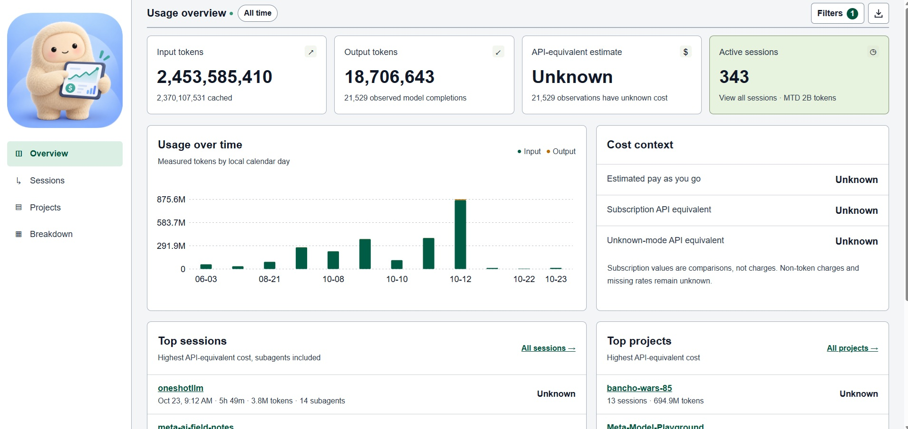

# Meta Cost Center

Track your tokens and cost, set more robust billing alarms, and integrates with [Meta Keyguard](https://github.com/omenking/meta-keyguard) to kill keys if you hit your spend limit.




Meta Cost Center tracks how much you use Muse Code and roughly what that usage would
cost at API rates. It reads the usage records that Muse already keeps on your machine,
stores them in a local SQLite database, and shows them in a dashboard in your browser,
broken down by project, model, and session. You can also set spending alerts and record
the amounts that actually appear on your bills.

Everything runs locally. The tool is a single binary with the dashboard built into it, so
it needs no API key, no hosted service, and no runtime to install, and it never makes
model calls of its own. It does not send your data anywhere.

The costs it shows are estimates, not bills. They are calculated from public per-token
prices, so they leave out taxes, credits, non-token charges, and anything covered by a
subscription, and they cannot include usage that was never logged on this machine.

## Requirements

- Linux or WSL, on amd64 or arm64
- A web browser

Go is needed only to build from source, and Node only if you change the frontend code,
because the built dashboard is already included in the repository.

## Install

Install the latest release into `~/.local/bin`:

```bash
curl -fsSL https://raw.githubusercontent.com/omenking/meta-costcenter/main/install.sh | sh
```

The script downloads the archive for your architecture, checks it against the release's
checksums, and installs the `muse-cost` binary; set `MUSE_COST_INSTALL_DIR` to install it
somewhere else. If Go is installed, `go install github.com/omenking/meta-costcenter/cmd/muse-cost@latest`
builds the same binary into `~/go/bin` instead. Upgrading is a matter of running either
command again, and the database and configuration carry over unchanged.

## Quick start

Run:

```bash
muse-cost show
```

This starts a local server and opens the dashboard at `http://127.0.0.1:8765/`. If that
port is taken, a free one is chosen and printed instead. The first run imports your
existing Muse history in the background, so the page may fill in over a few seconds.
Leave the command running to keep the dashboard up to date, and press Ctrl+C when you
are finished.

If you are on WSL and no browser opens, copy the printed URL into a browser on Windows.
The server listens only on your own machine (loopback), so it is not reachable from
other computers.

Some useful variations:

```bash
muse-cost show --port 8766      # use a specific port
muse-cost show --port 0         # let the system pick a free port
muse-cost show --no-browser     # print the URL without opening a browser
```

## Using the dashboard

The sidebar links to six pages:

| Page | What it shows |
| --- | --- |
| **Overview** | Estimated cost for the selected period, the share of tokens that could be priced, the average per active day, a chart of cost (or tokens) over time, and cost by model. |
| **Sessions** | One row per Muse session, with any subagent usage counted under the session that started it. |
| **Projects** | Usage grouped by project. |
| **Breakdown** | A table of usage grouped by project, model, session, or billing mode, where clicking a row opens its page or filters to it. |
| **Pricing** | Per-token rates, including any rates you have entered for models without public pricing. |
| **Alerts** | Spending limits and their warning levels. |

Clicking a session opens a detail page showing the session's totals, a timeline, the
tree of subagents and how much each one used, a per-model split, and every recorded
model completion. Clicking a project opens a page listing that project's sessions and
models. These detail pages have their own URLs, so you can bookmark them.

The **Filters** drawer narrows the data by date range, project, model, session, and
billing mode. Active filters appear as chips beside the page title, which makes it clear
when a page is showing a subset of your data, and you can remove a filter by clicking
its chip. Filters are kept when you refresh the page. The **Export** button downloads
the usage that matches the current filters.

The dashboard updates on its own while `show` is running: the collector checks for new
Muse records every 15 seconds and the page checks for changes every two seconds. New
usage appears once Muse has finished writing a record, not token by token as a response
streams.

To see live updates without spending anything, run the demo, which writes synthetic
usage and prints a command to run in a second terminal:

```bash
go run ./examples/live-demo
```

## Command-line reports

The dashboard is the main interface, but the same data is available as plain-text
reports. These are handy over SSH or in scripts.

```bash
muse-cost today                         # today's usage
muse-cost week                          # this week
muse-cost month                         # this month
muse-cost sessions --sort estimated-cost
muse-cost session SESSION_ID            # one session in detail
muse-cost projects
muse-cost models
muse-cost export --format csv --period month
muse-cost export --format json --period all
muse-cost scan                          # import new records without showing anything
muse-cost watch --interval 15           # reprint reports on an interval
muse-cost tui                           # interactive terminal dashboard
muse-cost doctor                        # check sources and setup
```

Most commands accept the same filters, and when you pass them to `show` they set the
dashboard's starting view:

```bash
muse-cost show --period month --interval 2
muse-cost show --project my-project --model muse-spark-1.3
muse-cost show --session SESSION_ID --period all
muse-cost show --from 2026-10-01 --to 2026-10-24 --billing-mode payg
```

Filter values must match labels exactly, and multiple filters are combined, so
`--project a --model b` shows only usage that matches both. Date ranges include both end
dates and follow your machine's local calendar.

These options work with every command:

- `--source PATH` reads from a different Muse session directory or a single JSONL file.
  You can repeat it to read from several places.
- `--db PATH` uses a different SQLite database.
- `--config PATH` uses a different configuration file.
- `--prices PATH` adds a pricing file (see [Estimated costs](#estimated-costs)).

Run `muse-cost --help` or `muse-cost COMMAND --help` for the full list.

## Projects and billing modes

Each session is assigned to a project automatically, using the name of the workspace
folder that Muse recorded for it. Sessions without that information are shown as
`unassigned`. Subagents do not record a workspace, so their usage goes to the project
of the session that started them. The tool never guesses a project from the contents of
your prompts.

The billing mode records whether a session was paid through a subscription or
pay-as-you-go (`payg`). Muse does not log this, so every session starts as `unknown`
until you set it. Both the project and the billing mode can be set per session in the
configuration file, which lives at `~/.config/meta-cost-center/config.toml` by default
(or under `$XDG_CONFIG_HOME` if you have set it):

```toml
[sessions."your-session-id"]
project = "my-project"
billing_mode = "subscription"   # subscription, payg, or unknown
```

A fuller example is in [examples/config.toml](examples/config.toml). Changes take
effect on the next scan, including for sessions that were imported earlier.

## Estimated costs

Costs are estimated from a bundled snapshot of
[Meta's published pricing](https://dev.meta.ai/docs/pricing-rate-limits), dated
2026-10-24 and stored in
[pricing.json](pricing.json), which is built into the binary. That file contains only
publicly documented models.

The dashboard uses two markers on cost figures:

- **≈** means the estimate relies on an assumed rate. This happens for usage recorded
  before the date a price was verified, which is priced at the earliest rate known for
  that model. Exports flag the same rows with `rate_assumed`.
- **+** means the total is only partly priced, because some of its usage has no known
  rate or is missing cache token counts. The real figure is at least the amount shown.

For a model that has no public price, such as an internal or preview model, you can
enter a rate on the **Pricing** page. Those rates are saved only in your local database
and never in the project files, so the names of private models are not committed to
the repository. A rate you enter replaces the public rate for that model and applies to
all dates.

If you have audited historical rates, you can supply them with `--prices path.json`.
The file uses the same format as the bundled `pricing.json`, where each entry gives the
model ID, the three per-million-token rates in USD, the date the rate took effect, a
source URL, the retrieval date, and a snapshot version. When more than one rate applies,
the one with the most recent effective date is used.

## Spending alerts

Alerts are created on the **Alerts** page. Each alert has a limit in US dollars over a
day, a week (starting Monday), or a calendar month, and it can cover all projects or a
single project and, optionally, only pay-as-you-go usage. An alert can have up to four
warning levels expressed as a percentage of the limit, with 80% as the default.

When spending passes a warning level or the limit, a bar appears across the top of every
dashboard page. If you allow it, the dashboard also sends a desktop notification, once
per alert, period, and level, as long as a dashboard tab is open.

Keep two things in mind. First, alerts only warn you and never stop Muse from running.
Second, usage without a known price is left out of the spending total, so the real
amount may be higher than the alert reports.

You can also create a monthly alert from the command line. The following command sets a
$30 monthly limit for all projects with warnings at 50% and 80%:

```bash
muse-cost alert set --monthly-usd 30 --at 50,80,100
```

Alerts that have reached a warning level or their limit are also listed in the text
reports.

### Revoking Meta API keys with Meta Keyguard

Alerts can also ask [Meta Keyguard](https://github.com/omenking/meta-keyguard) to revoke Meta
API keys once their limit is exceeded. In the alert dialog, turn on **Revoke Meta API keys
when the limit is exceeded** and enter which keys: `*` for every key, `bootcamp-*` for keys
whose names start with `bootcamp-`, or `key1,key2` for specific keys. The same can be set
from the command line:

```bash
muse-cost alert set --monthly-usd 30 --revoke-keys 'bootcamp-*'
```

Cost Center itself never deletes anything. Keyguard reads the alerts with the following
command, which imports any new usage first and prints every alert's level and key match as
JSON, and it acts on them only when its own Cost Center check is turned on:

```bash
muse-cost alert status --json
```

The **Alerts** page shows what Keyguard is doing, which needs Cost Center to know how to run
it. Add the path to your configuration file if `keyguard` is not on your `PATH`:

```toml
keyguard_command = "/home/you/.local/bin/keyguard"
```

With that set, each alert that revokes keys shows one of three things: the keys it covers
right now, the keys Keyguard revoked for it in the current period, or, in red, why it is
**not enforced** (for example, Keyguard's Cost Center check is off or Keyguard cannot be
found). The alert bar adds the same information when a limit is exceeded. A Meta Keyguard
panel lists the keys Keyguard manages and any failure it last reported, and the key match
field in the alert dialog previews which current keys a pattern covers as you type. Cost
Center reads all of this from `keyguard status --json`, which never contains a secret, and
it runs that command only while an alert revokes keys or the Alerts page is open.

## Recording actual bills

Because the estimates cannot account for taxes, credits, currency conversion, or billing
delays, the tool does not try to match them against your real bills automatically.
Instead, you can record what your account actually shows so that both numbers are kept
side by side:

```bash
muse-cost reconcile add --date 2026-10-24 --from 2026-10-01 --to 2026-10-24 \
  --amount 12.34 --currency CAD --kind outstanding-balance --scope team
muse-cost reconcile list
```

## Where data is stored

| What | Default location |
| --- | --- |
| Muse logs that are read | `~/.local/share/muse/sessions` |
| Usage database | `~/.local/share/meta-cost-center/costs.sqlite3` |
| Configuration | `~/.config/meta-cost-center/config.toml` |

These paths follow `$XDG_DATA_HOME` and `$XDG_CONFIG_HOME` when they are set.

## Privacy

The tool only reads Muse's logs and never modifies them, and it does not read any
authentication files. From each record it keeps token counts, model names, timestamps,
and the identifiers needed to trace where the record came from. Your prompts, the
model's responses, and tool output are never saved, although they pass through memory
briefly while each log line is parsed.

The data directory is created readable only by you (`0700`), and so is the database
(`0600`). The output of `doctor` includes local file paths to help with troubleshooting,
whereas exports leave them out so that they are safe to share.

## Limitations

- **Only local, retained logs are counted.** Usage from other machines, direct API
  calls, sessions with logging turned off, and logs that have been deleted cannot be
  seen. An empty report therefore does not prove that nothing was used.
- **Parsing was built against Muse 1.4.12.** The tool reads `model_completed` events
  from session, subagent, observer, and approval-review logs. A later Muse version that
  changes its log format may need an update. Models it does not recognise are still
  recorded, but they are left unpriced.
- **Usage is never counted twice or silently dropped.** Records copied between files
  are matched by their IDs. A line that is still being written is read once it is
  complete, while malformed records are reported by `doctor` and never discarded
  without notice. If a log file is truncated or replaced, earlier imported usage is
  kept even though the original file may be gone.
- **Headless runs are counted from their native logs.** A `run.usage` summary format is
  recognised for comparison, but summaries are never added to the totals, and
  summaries that cover multiple runs have not been fully validated.

## Development

### Building and testing

```bash
go build -o muse-cost ./cmd/muse-cost   # embeds web/ and pricing.json into the binary
go test ./...
```

The tests cover log parsing, incremental imports, deduplication, pricing, alerts,
database migrations, privacy, the Keyguard integration, the CLI, the terminal dashboard
(driven through a pseudo-terminal), the web server, live updates, filters, and exports.
None of them make model calls.

Optional browser tests drive the dashboard in an installed copy of Google Chrome with
Playwright. They build the binary with Go, or use the one named by `MUSE_COST`, and run it
against a fixture of synthetic logs:

```bash
npm ci --prefix frontend
npm run test:browser --prefix frontend
```

Set `CHROME_PATH` to use a browser other than the installed Google Chrome.

### Releases

Releases are built by GoReleaser from `.goreleaser.yaml` (`goreleaser release` on a tag),
which publishes the `muse-cost_linux_amd64.tar.gz` and `muse-cost_linux_arm64.tar.gz`
archives that `install.sh` downloads. Changes to `web/` or `pricing.json` reach users
only through a new binary, since both are embedded in it.

### Changing the frontend

The dashboard is a React app. Its source is in `frontend/src/` (with pages in
`frontend/src/pages/`), and its styles are in `web/style.css`. Because the binary embeds
a prebuilt bundle, `web/app.js`, rebuild the bundle after changing any React code and
then rebuild the binary:

```bash
npm ci --prefix frontend
npm run build --prefix frontend
go build -o muse-cost ./cmd/muse-cost
```

The build uses esbuild and bundles React and React Router into a single local file, so
the dashboard loads nothing from a CDN at runtime. Dependency versions are pinned in
`frontend/package-lock.json`.

### Project plans

Design notes and the intended scope are in the [plans](plans/) directory, starting with
[plans/PLAN.md](plans/PLAN.md).
