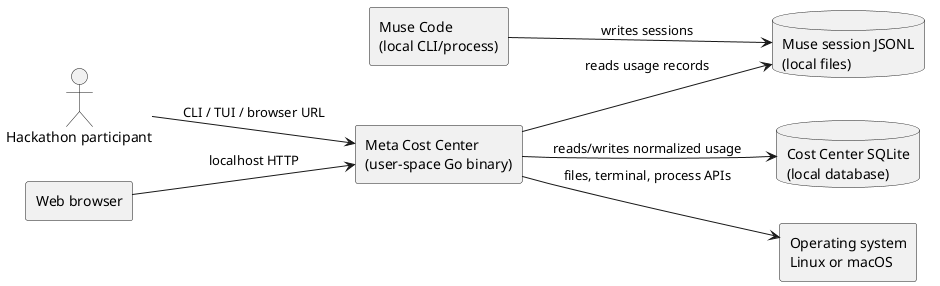
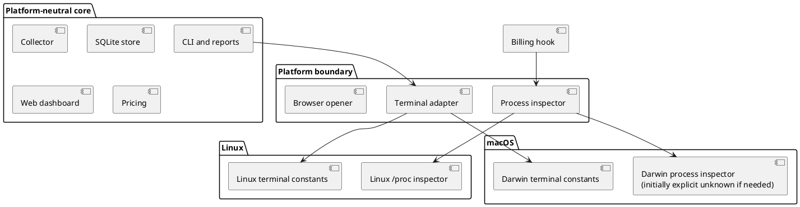
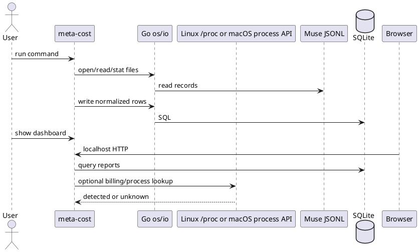
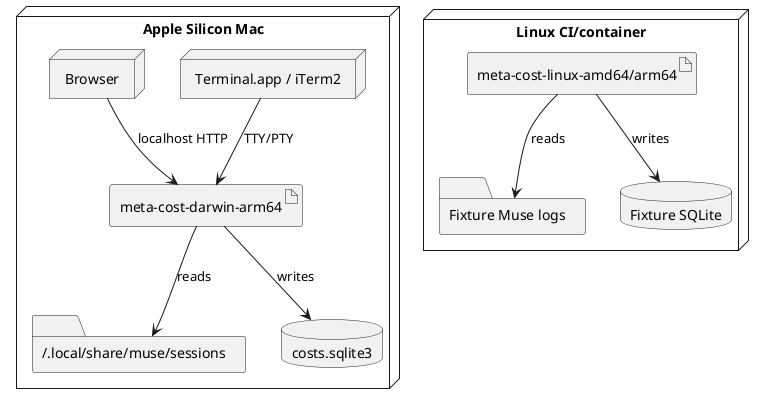

# Software Architecture Document — Meta Cost Center macOS arm64 Port

Status: design draft for review  
Branch: `macos-arm64-port`  
Scope: porting the existing Go application to macOS arm64 while preserving Linux behavior.

## 1. Introduction and goals

Meta Cost Center is a local Go application that imports Muse Code session logs, stores normalized usage in SQLite, estimates cost from a local pricing snapshot, and exposes CLI, terminal, and browser views.

The design goal is not to port an operating system. It is to keep the application in user space and isolate the small number of places where Linux and macOS expose different operating-system interfaces.

The design must support these outcomes:

- Build and run the supported application path on macOS arm64.
- Keep Linux behavior working.
- Make Linux-only billing detection explicit instead of silently changing its meaning.
- Give a contributor a concrete way to learn the OS boundary through small experiments.

## 2. Architecture drivers and constraints

- The application is a single local Go binary with an embedded web dashboard and pricing data.
- Muse Code session logs are local JSONL files under `${XDG_DATA_HOME:-$HOME/.local/share}/muse/sessions`.
- The port targets `darwin/arm64`; Linux amd64 and arm64 remain supported.
- Cross-compilation should work with `CGO_ENABLED=0` unless a later decision introduces a C-based macOS adapter.
- Billing-mode detection currently inspects Linux `/proc` process data. macOS has no standard `/proc` filesystem.
- A third-party `/proc` emulator is explicitly out of scope because it would require privileged system installation and weaken the portability story.
- The runtime remains local; no model calls or hosted backend are introduced by this port.

## 3. Context and scope

### 3.1 System context view

The system context is intentionally application-sized. The operating system is shown as an external boundary, not decomposed into a full kernel architecture.



### 3.2 Boundaries

- **User space:** `meta-cost`, Muse, browser, and SQLite files.
- **OS boundary:** Go standard library and `golang.org/x/sys/unix` calls.
- **Kernel space:** Linux kernel or macOS XNU; not modified by this project.
- **External optional integration:** Meta Keyguard is queried as a separate local command; it is not required for collection.

## 4. Solution strategy

1. Keep collector, pricing, SQLite, reports, CLI parsing, and web handlers platform-neutral.
2. Put terminal constants and terminal operations behind OS-specific files.
3. Put process inspection behind a small interface or boundary so `/proc` is not spread through the application.
4. Start macOS with an explicit unsupported/unknown billing-detection result if no safe native implementation is ready.
5. Use Structurizr DSL as the canonical C4 model for context, containers, and deployment.
6. Use PlantUML for detailed OS views where the important story is a syscall, process lookup, terminal ioctl, or data path.
7. Validate portable logic with unit tests on both OSes and validate OS-specific behavior with platform-specific tests.

## 5. Building-block view

### 5.1 Current logical components

| Component | Responsibility | OS sensitivity |
|---|---|---|
| CLI parser | Commands, options, filters, exit codes | Low |
| Collector | Reads JSONL, validates usage, tracks file offsets | Low; file identity must be checked on both OSes |
| Store | SQLite schema and persistence | Low |
| Pricing/reports | Rates, estimates, exports, text reports | Low |
| Web dashboard | Local HTTP server and embedded frontend | Low; browser opener differs |
| Terminal dashboard | Raw mode, terminal size, key decoding | Medium/high |
| Billing hook | Parent process and credential detection | High; Linux `/proc` today |
| Keyguard bridge | Runs local `meta-keyguard` command | Medium; command availability varies |

### 5.2 Proposed OS boundary



## 6. OS-specific views

### 6.1 Process-management view

The billing hook needs to understand the Muse process that launched it. On Linux it walks parent PIDs and reads `/proc/<pid>/stat`, `cmdline`, and `environ`. On macOS, the equivalent information must come from Darwin process APIs or a changed hook contract.

The first safe design is an explicit provider boundary:

```text
Billing hook -> ProcessInspector
             -> LinuxProcInspector on Linux
             -> DarwinInspector on macOS
             -> Unknown/Unsupported result when capability is unavailable
```

This keeps the billing rule visible and testable. It avoids installing a kernel extension or pretending that a Linux path exists on macOS.

### 6.2 Terminal and TTY/PTY view

TTY and PTY concepts exist on both systems. The difference is in the termios structure and ioctl request constants. The common TUI logic should handle keys, rendering, refresh, and filters; OS-specific files should provide the constants and calls needed to query terminal state and enter raw mode.

The TUI does not need kernel code. It asks the OS for terminal state through `x/sys/unix` and receives input through the terminal file descriptor.

### 6.3 Filesystem and data view

The collector reads Muse JSONL files and writes the Cost Center SQLite database. Muse Code documentation shows the XDG-style session path on macOS and Linux, so the existing data-root abstraction is a strong starting point. The design must still allow an explicit `--source` override for diagnosis.

### 6.4 System-call/data-flow view



Interrupts, DMA, spinlocks, and kernel memory maps are not in scope because this application does not implement them directly.

## 7. Runtime view

### 7.1 Dashboard runtime

1. User starts `meta-cost show`.
2. The application opens/creates the local SQLite database.
3. The collector scans configured Muse roots and imports new records.
4. The HTTP server serves the embedded dashboard on loopback.
5. A background scan and browser refresh make new completed usage visible.
6. The application attempts to open the desktop browser using platform commands.

### 7.2 Billing hook runtime

1. Muse invokes the SessionStart hook and provides the session payload.
2. The hook asks the platform process inspector for billing evidence.
3. The inspector returns a detection or an explicit unknown/unsupported result.
4. The result is stored without exposing the API key value.
5. The hook must never block Muse or print model-context content to stdout.

## 8. Deployment view



Docker is useful for a repeatable Linux baseline. It cannot prove macOS kernel/API behavior; macOS-specific tests require a native macOS environment or a macOS CI runner.

## 9. Test strategy

### 9.1 Unit tests

- JSONL parsing and validation.
- File-offset and duplicate-scan logic using fixtures.
- Pricing, decimal math, filters, reports, and configuration.
- Billing decision rules with a fake `ProcessInspector`.
- TUI key decoding and rendering helpers that do not require a real terminal.

### 9.2 Platform tests

- Linux process inspector tests use a fake `/proc` tree; they do not inspect the host's real processes.
- Darwin process inspector tests use controlled fixtures or an explicit unsupported result until a native implementation is approved.
- Terminal tests use a PTY adapter per OS; Linux-only PTY constants must not be compiled into Darwin tests.
- Native build checks compile and, where possible, execute the target binary.

### 9.3 Baseline comparison

The same portable fixture should be imported on Linux and macOS. The normalized rows, estimates, filters, and exports should match. Platform-specific differences must be listed explicitly, especially billing mode.

## 10. Architecture decisions

### ADR-001 — Do not install a macOS `/proc` emulator

Use native APIs or an explicit unsupported result. A third-party procfs kernel extension is too invasive for a local cost tool and would introduce privileged installation, SIP, kernel-version, and maintenance risks.

### ADR-002 — Keep OS code behind narrow boundaries

Use OS-specific Go files and small interfaces rather than scattering `runtime.GOOS`, `/proc`, or ioctl constants throughout the core.

### ADR-003 — Use Structurizr and PlantUML together

Structurizr is the model-driven source for C4 context/container/deployment views. PlantUML is used for detailed process, terminal, and syscall/data-flow views. Both are text files in Git.

## 11. Risks and open decisions

- Muse may change its log format or process behavior without a stable public contract.
- macOS process permissions and hardened-process rules may prevent reading all parent-process details.
- The current release configuration includes Darwin amd64 as well as arm64; decide whether to keep that extra artifact.
- A native Darwin billing detector may need cgo or a changed hook contract; preserve `CGO_ENABLED=0` until evidence requires otherwise.
- The exact PTY strategy for macOS integration tests needs a small experiment.

## 12. Learning path

The port is divided into small OS experiments:

1. Build a pure Go command for `darwin/arm64`.
2. Read a known Muse fixture and write SQLite rows.
3. Compare Linux `/proc` and Darwin process information without reading secrets.
4. Run a terminal-size/raw-mode experiment on both TTYs.
5. Run the same fixture-based unit tests on Linux and macOS.
6. Only then decide whether native billing detection is worth implementing.

## 13. References

- [Go on ARM and Darwin](https://go.dev/wiki/GoArm)
- [Go build constraints](https://pkg.go.dev/go/build)
- [Go Unix package](https://pkg.go.dev/golang.org/x/sys/unix)
- [Linux proc filesystem](https://man7.org/linux/man-pages/man5/proc.5.html)
- [Linux termios](https://man7.org/linux/man-pages/man3/termios.3.html)
- [Apple process information](https://developer.apple.com/documentation/endpointsecurity/es_proc_check_type_pidinfo)
- [Muse Code local session logs](https://dev.meta.ai/resources/blog/build-with-muse-code)
- [Structurizr models as code](https://docs.structurizr.com/as-code)
- [C4-PlantUML](https://github.com/plantuml-stdlib/C4-PlantUML)
